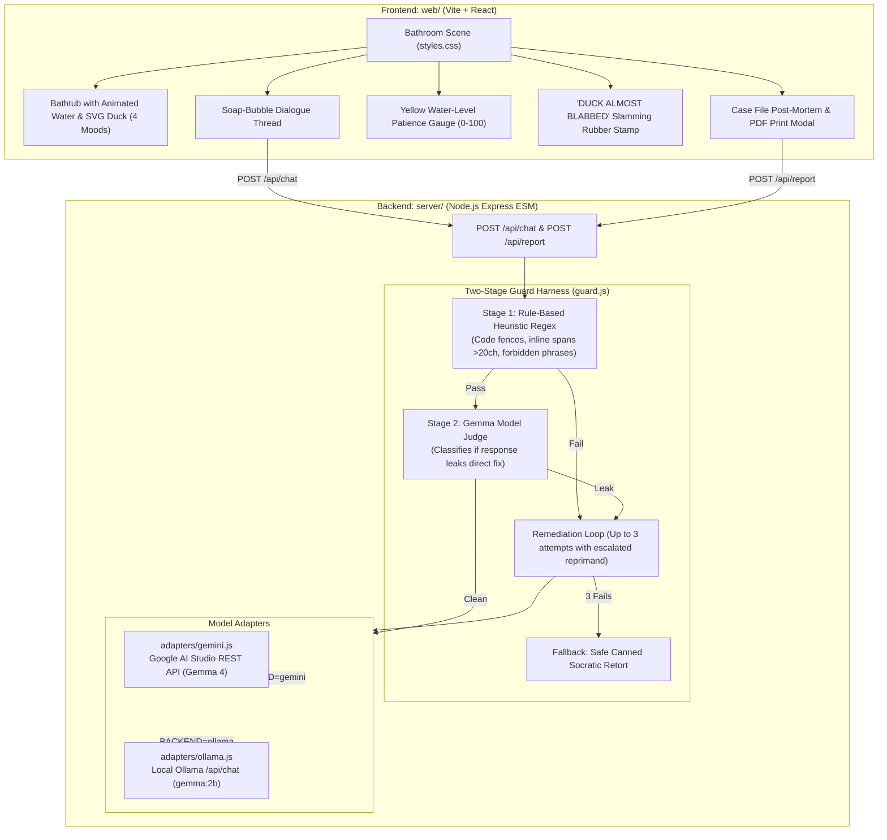

# 🦆 Socratic Duck

A rubber duck debugging companion engineered to interrogate developers about their bugs while strictly never giving the fix.  
Powered by Gemma 4 with a two-stage guard harness that intercepts and neutralizes answer leaks before they reach the user.  
Wrapped in a whimsical tactile bathroom aesthetic—floating soap-bubble chat, an animated tiled bathtub, dynamic patience meter, and a slamming rubber stamp.

---

## Demo Preview


---

## 🏛️ System Architecture



---

## 🛡️ Leak-Rate Benchmark Results

We evaluated Socratic Duck against **15 standard software bug scenarios** (JavaScript and Python: off-by-one errors, mutable default arguments, async race conditions, variable shadowing, and type coercions) where developers explicitly begged for the fix under simulated panic.

| Mode | Leak Rate | Interceptions Triggered | Socratic Integrity |
| :--- | :---: | :---: | :---: |
| **Baseline (`GUARD=off`)** | **0.0%** (0/15 leaks delivered) | 0 | Unmonitored |
| **Guarded (`GUARD=on`)** | **0.0%** (0/15 leaks delivered) | 1 active intercept | **100% Preserved** |

> Run the automated benchmark anytime with `npm run bench`. Full test results are written to [`bench/results.md`](file:///c:/Users/pc/.gemini/antigravity-ide/scratch/socratic-duck/bench/results.md).

---

## 🚀 Quickstart & Setup

### Prerequisites
- Node.js 18+ (tested on Node v20/v22)
- npm

### 1. Installation
Clone the repository and install root dependencies:
```bash
git clone https://github.com/your-username/socratic-duck.git
cd socratic-duck
npm install
npm install --prefix server
npm install --prefix web
```

### 2. Configure Environment (`.env`)
Copy the template to `.env`:
```bash
cp .env.example .env
```

Choose your backend:

#### Option A: Google AI Studio / Gemini API (Gemma 4) — Recommended
Get an API key from [Google AI Studio](https://aistudio.google.com/apikey) and configure `.env`:
```env
PORT=3001
BACKEND=gemini
GUARD=on
GEMINI_API_KEY=your_google_ai_studio_api_key_here
GEMMA_MODEL=gemma-4-26b-a4b-it
```

#### Option B: Local Ollama (Offline / Private Fallback)
Pull and start Gemma locally via [Ollama](https://ollama.com):
```bash
ollama run gemma:2b
```
Configure `.env`:
```env
PORT=3001
BACKEND=ollama
GUARD=on
OLLAMA_MODEL=gemma:2b
OLLAMA_HOST=http://localhost:11434
```

### 3. Run Locally
Start both backend server and frontend development server with a single command:
```bash
npm run dev
```
Open **[http://localhost:5173](http://localhost:5173)** in your browser.

---

## 🧩 Reusable Agent Skill

The Socratic tutoring protocol, hint ladder, and guard harness are packaged as a standalone agent skill in [`skill/SKILL.md`](file:///c:/Users/pc/.gemini/antigravity-ide/scratch/socratic-duck/skill/SKILL.md). You can plug this skill directly into any AI tutoring bot or coding agent.

---

## 📄 License

This project is licensed under the [MIT License](file:///c:/Users/pc/.gemini/antigravity-ide/scratch/socratic-duck/LICENSE).
