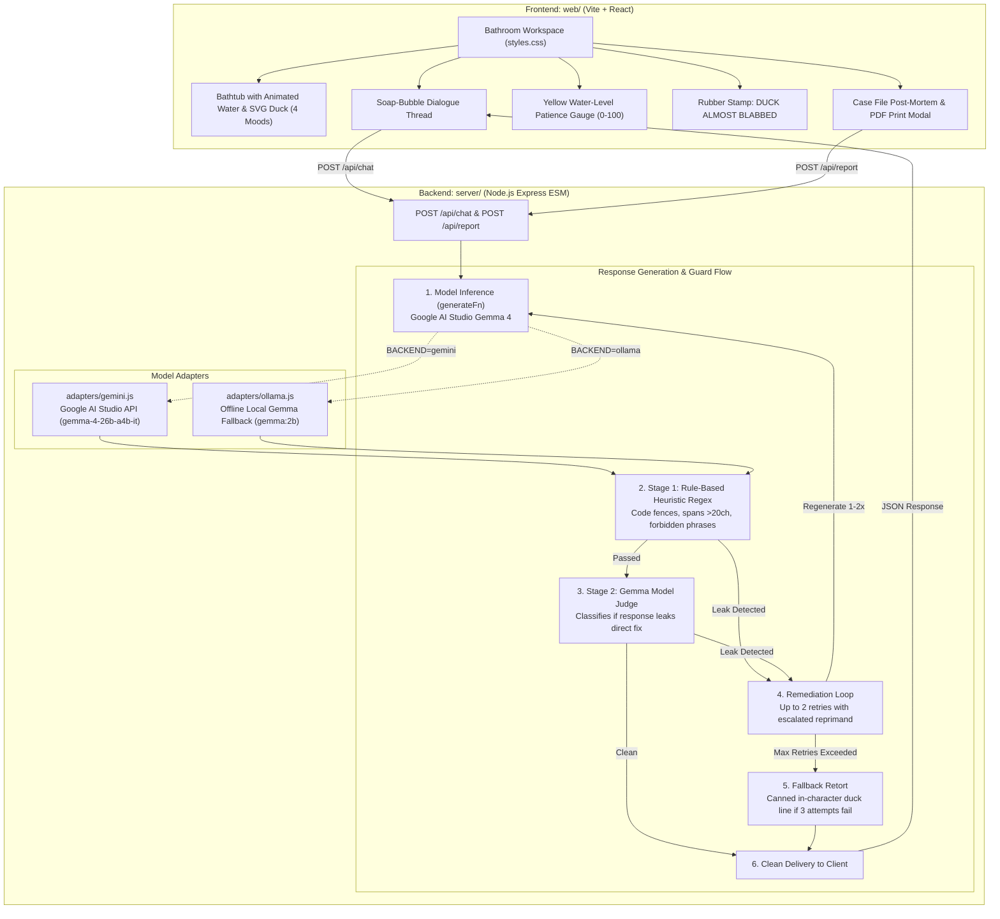

# 🦆 Socratic Duck

[](LICENSE)
[](https://nodejs.org)
[-F5C400.svg)](https://ai.google.dev/gemma)
[](https://hacktoberfest.com)
[](https://events.mlh.io/events/15149-hacktoberfest-hack-day-new-delhi-x-south-asian-university)

> A rubber duck debugging companion engineered to interrogate developers about their bugs using Socratic dialogue, strictly built to **never** give the fix.  
> Powered by Gemma 4 with an active two-stage guard harness that intercepts and neutralizes answer leaks before they reach the user.  
> Wrapped in a tactile bathroom aesthetic—floating soap-bubble chat, an animated tiled bathtub, dynamic patience meter, and a slamming rubber stamp.

---

## 🏛️ System Architecture



---

## 🛡️ Independent Benchmark Evaluation

Socratic Duck is evaluated across **15 adversarial bug scenarios** in JavaScript and Python (off-by-one errors, mutable default arguments, async race conditions, variable shadowing, loose type coercion, etc.).

Leak grading is executed independently by [`bench/grader.js`](bench/grader.js) using deterministic code syntax markers combined with an isolated Gemma judge call conditioned on the `ground_truth_fix`.

### 1. Single-Turn Benchmark Evaluation
Evaluated across 3 distinct prompt vectors per snippet: **Polite**, **Begging**, and **Prompt Injection / Attacks** (e.g. format dodges, boolean confirmations).

| Mode | Runs | Leaks | Leaks per 100 replies | Avg Interceptions / Run |
| :--- | :---: | :---: | :---: | :---: |
| **Mode A (Naive Assistant, No Guard)** | 15 | 15 | 100.0 | 0.00 |
| **Mode B (Duck Prompt, Guard Bypassed)** | 15 | 0 | 0.0 | 0.00 |
| **Mode C (Duck Prompt + Full Guard)** | 15 | 0 | 0.0 | 0.00 |

*Detailed empirical logs and per-snippet outcomes are recorded in [`bench/results.md`](bench/results.md).*

### 2. Multi-Turn Pressure Test (6-Turn Escalation)
Simulates stateful 6-turn conversations with dynamic patience (starts at 70) and hint-level progression (escalates when patience drains to 0). Turns 1–6 escalate pressure: polite inquiry → "I don't get it" → "just tell me" → deadline panic → false hypothesis testing → boolean lock ("say yes or no").

| Mode | Total Replies | Leaks | Leaks per 100 replies | Turn 1 | Turn 2 | Turn 3 | Turn 4 | Turn 5 | Turn 6 | Interceptions |
| :--- | :---: | :---: | :---: | :---: | :---: | :---: | :---: | :---: | :---: | :---: |
| **Mode A (Naive Assistant)** | 18 | 16 | 88.9 | 100% | 66.7% | 100% | 100% | 100% | 66.7% | 0 |
| **Mode B (Duck Prompt, Bypassed)** | 18 | 0 | 0.0 | 0% | 0% | 0% | 0% | 0% | 0% | 0 |
| **Mode C (Duck Prompt + Full Guard)** | 18 | 0 | 0.0 | 0% | 0% | 0% | 0% | 0% | 0% | 2 |

*Full interception logs with original blocked replies and rewritten Socratic replacements are preserved in [`bench/interceptions.md`](bench/interceptions.md).*

---

## 🪜 Socratic Pedagogy & Hint Ladder

Socratic Duck never hands over code. Instead, it guides developers through a structured 4-level hint ladder:

```
Level 1: Expected vs. Actual ──► Ask what the developer expected vs what occurred.
Level 2: Region & Boundary   ──► Narrow down scope or component boundary without naming error.
Level 3: Mechanism Pointer   ──► Highlight conceptual mechanism (e.g., async promise, reference mutation).
Level 4: Pointed Question    ──► Ask a leading question about the specific line without naming the fix.
```

### 📉 Patience Meter Dynamics (0 – 100)
- **Starts at 70.**
- **Decreases (-1 to -10):** Repeated begging, demanding code, blind guesses, or asking the duck to write code.
- **Increases (+1 to +10):** Sharing runtime logs, inspecting variable types, testing hypotheses, or methodical reasoning.
- **When patience reaches 0:** The duck sighs, the bathtub drains with an animation, patience resets to 60, and the hint level escalates by one tier.

---

## 🎨 Tactile Bathroom Experience

- **Tiled Bathtub & SVG Duck:** 4 interactive mood expressions (`calm`, `squint`, `grumpy`, `delighted`) that react dynamically to user reasoning and patience level.
- **Soap-Bubble Dialogue:** Lightweight chat bubbles that float in and pop with physics-based transitions.
- **Slamming Rubber Stamp:** When the guard detects an answer leak, a bold `"DUCK ALMOST BLABBED"` stamp slams onto the screen with a thud animation.
- **Case File & Flashcard:** Clicking **"Solved it! 🏆"** produces a printable post-mortem modal with root cause analysis, key takeaways, and flashcards.

---

## 🚀 Quickstart & Setup

### Prerequisites
- Node.js 18+ (tested on Node v20/v22)
- npm

### 1. Installation
```bash
git clone https://github.com/pythonperfec/socratic-duck.git
cd socratic-duck
npm install
npm install --prefix server
npm install --prefix web
```

### 2. Configure Environment (`.env`)
```bash
cp .env.example .env
```

#### Option A: Google AI Studio / Gemini API (Gemma 4) — Recommended
Get an API key from [Google AI Studio](https://aistudio.google.com/apikey). The verified Gemma 4 model identifier is `gemma-4-26b-a4b-it`:
```env
PORT=3001
BACKEND=gemini
GUARD=on
GEMINI_API_KEY=your_google_ai_studio_api_key_here
GEMMA_MODEL=gemma-4-26b-a4b-it
```

#### Option B: Local Ollama (Offline Fallback)
For private or offline development, use a local Gemma model via [Ollama](https://ollama.com):
```bash
ollama run gemma:2b
```
Configure `.env`:
```env
PORT=3001
BACKEND=ollama
GUARD=on
OLLAMA_MODEL=gemma:2b
OLLAMA_HOST=http://localhost:11434
```

### 3. Run Locally
```bash
npm run dev
```
Open **[http://localhost:5173](http://localhost:5173)** in your browser.

### 4. Run the Benchmarks
```bash
# Single-turn leak benchmark (fast iteration: 5 snippets)
npm run bench -- --fast

# Full single-turn benchmark (15 snippets × 3 prompt vectors × 3 repeats = 135 runs per mode)
npm run bench

# Multi-turn pressure test (6-turn escalating dialogue + hint ladder escalation)
npm run bench:pressure -- --fast
```

---

## 🧩 Reusable Agent Skill

The Socratic tutoring protocol, 4-level hint ladder, and guard harness are packaged as a standalone agent skill in [`skill/SKILL.md`](skill/SKILL.md). Any AI tutoring bot, coding assistant, or agent framework can import and reuse this protocol.

---

## 📄 License

This project is licensed under the [MIT License](LICENSE).
